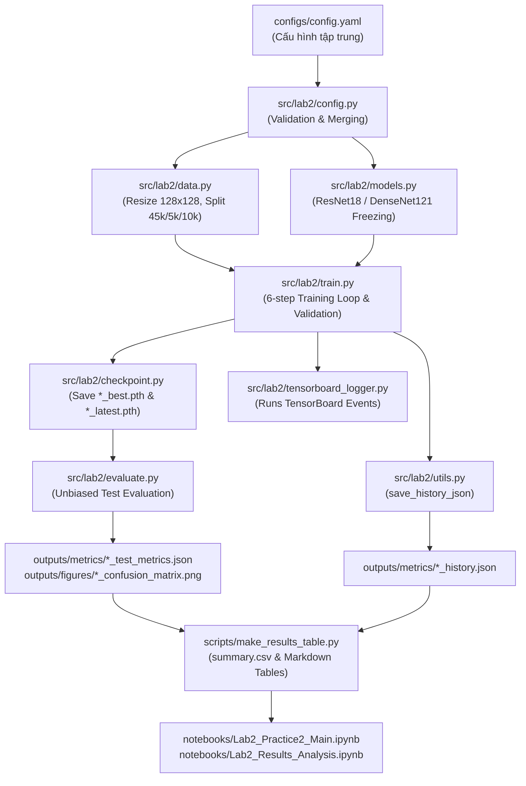

# Lab 2: Pretrained Models, Transfer Learning & Fine-Tuning (CIFAR-10)


Dự án tuân thủ các nguyên tắc kỹ thuật: **Source-First, Design-First, Test-Driven, Reproducible và CPU-First**.

---

## 1. Project Overview

Dự án nghiên cứu, thực nghiệm và so sánh đối chứng việc áp dụng các mô hình học sâu huấn luyện sẵn (Pre-trained Models từ `torchvision.models`) trên bộ dữ liệu ảnh CIFAR-10. Trọng tâm của bài toán là làm rõ cơ chế thích nghi mô hình qua 2 phương pháp:
- **Transfer Learning (Feature Extraction):** Đóng băng toàn bộ các tầng trích xuất đặc trưng của backbone, chỉ huấn luyện lại tầng phân loại mới (classifier head).
- **Fine-Tuning:** Đóng băng các tầng đầu và mở khóa các khối tích chập sâu nhất cùng với classifier head, kết hợp với kỹ thuật **Differential Learning Rate** (tốc độ học backbone nhỏ hơn 10 lần so với head) để tinh chỉnh biểu diễn đặc trưng theo miền dữ liệu mới mà không làm mất tri thức học sẵn.

Hệ thống được thiết kế tối ưu hóa cho môi trường CPU-First, cung cấp đầy đủ mã nguồn modular, kịch bản dòng lệnh CLI, kịch bản sinh bảng kết quả tự động, 2 Jupyter Notebooks chuẩn hóa và bộ kiểm thử tự động 62 unit tests (đạt 100% passed).

---

## 2. Problem Statement

- **Bộ dữ liệu:** CIFAR-10 gồm 60.000 ảnh màu kích thước gốc $32 \times 32$ thuộc 10 lớp phân loại (`airplane`, `automobile`, `bird`, `cat`, `deer`, `dog`, `frog`, `horse`, `ship`, `truck`).
- **Thách thức kỹ thuật:**
  1. *Độ phân giải khác biệt:* Kích thước ảnh CIFAR-10 ($32 \times 32$) nhỏ hơn nhiều so với kích thước huấn luyện chuẩn của ImageNet ($224 \times 224$), đòi hỏi tiền xử lý nội suy (resize lên $128 \times 128$) và chuẩn hóa kênh màu.
  2. *Ràng buộc tài nguyên tính toán:* Thực thi trên môi trường CPU (Intel Core i5, không GPU NVIDIA), đòi hỏi giải pháp tối ưu luồng dữ liệu, kích thước batch và cờ `--smoke-test` phục vụ kiểm thử nhanh pipeline.
  3. *Hiện tượng cập nhật thống kê BatchNorm trong backbone đóng băng:* Khi gọi `model.train()`, các tầng BatchNorm dù có `requires_grad=False` vẫn cập nhật `running_mean` và `running_var` theo batch dữ liệu mới (đã được đo đạc thực nghiệm tại Phase 6).

---

## 3. Main Features

- **Kiến trúc mã nguồn theo module (Modular Architecture):** Tách biệt các tầng trách nhiệm: cấu hình (`config.py`), dữ liệu (`data.py`), kiến trúc mô hình (`models.py`), huấn luyện (`train.py`), đánh giá (`evaluate.py`), checkpoint (`checkpoint.py`), và giám sát (`tensorboard_logger.py`).
- **Quy trình huấn luyện tuân thủ 6 bước chuẩn (Slide 8–9):** Thực thi đúng trình tự `model.train()` $\to$ `zero_grad()` $\to$ forward pass $\to$ compute loss $\to$ backward pass $\to$ `optimizer.step()`.
- **Hỗ trợ đầy đủ 3 bài tập của Practice 2 (Slide 23):**
  - *Exercise 1:* So sánh đối chứng ResNet-18 và DenseNet-121.
  - *Exercise 2:* Khảo sát tác động khi thay đổi siêu tham số (Learning Rate $10^{-4}$ và Batch Size $32$) với cấu hình kiểm soát biến độc lập nghiêm ngặt.
  - *Exercise 3:* Tích hợp giám sát TensorBoard (Scalars, Graphs, Images, Histograms).
- **Bộ kiểm thử tự động (Test-Driven):** 62 tests độc lập chạy offline (không yêu cầu tải dữ liệu hay trọng số pre-trained khi chạy test, thời gian thực thi ~13 giây).
- **Gia cố độ tin cậy hệ thống (System Hardening):** Deep snapshot lưu trạng thái checkpoint tốt nhất, cách ly BatchNorm khi ghi log đồ thị TensorBoard, loại bỏ bypass SSL mất an toàn, phòng thủ kiểm tra siêu tham số và phát hiện giá trị Loss bất thường (`NaN`/`Inf`).
- **Tự động hóa kết quả (Automated Reporting):** Tự động lưu lịch sử huấn luyện dạng JSON và script `make_results_table.py` tự động xuất bảng CSV và Markdown đối chiếu.

---

## 4. System Architecture



---

## 5. Folder Structure

Cấu trúc thư mục được trích xuất trực tiếp từ kho lưu trữ Git:

```
.
├── .gitignore                         # Loại trừ dataset, checkpoint nặng, runs
├── AGENTS.md                          # Quy chuẩn thực hiện dự án, Master Rules & DoD
├── README.md                          # Tài liệu hướng dẫn chính
├── requirements.txt                   # Danh sách thư viện phụ thuộc
├── configs/
│   └── config.yaml                    # Cấu hình siêu tham số tập trung (core & hparam)
├── data/
│   └── .gitkeep                       # Nơi lưu trữ dữ liệu CIFAR-10
├── docs/
│   ├── AI_Usage.md                    # Báo cáo minh bạch sử dụng AI
│   ├── experiment_plan.md             # Kế hoạch thực nghiệm và biến kiểm soát
│   ├── progress_status.md             # Bảng theo dõi tiến độ và bằng chứng kiểm toán
│   ├── project_description.md         # Mô tả bài toán và bảng đối chiếu yêu cầu
│   ├── project_design.md              # Thiết kế chi tiết hệ thống và interface
│   └── results.md                     # Báo cáo kết quả và phân tích thực nghiệm
├── notebooks/
│   ├── Lab2_Practice2_Main.ipynb      # Notebook chính theo 7 bước đề bài Practice 2
│   └── Lab2_Results_Analysis.ipynb    # Notebook phân tích kết quả chuyên sâu (chỉ đọc)
├── outputs/
│   ├── figures/                       # Hình ảnh ma trận nhầm lẫn (*.png)
│   └── metrics/                       # Kết quả JSON (*.json) và bảng tổng hợp (summary.csv)
├── checkpoints/                       # Nơi lưu trữ checkpoints mô hình (*.pth)
├── runs/                              # Nơi lưu trữ log sự kiện TensorBoard
├── scripts/
│   ├── check_frozen_bn.py             # Script đo lường hành vi BatchNorm bị đóng băng
│   ├── evaluate_checkpoints.py        # Script đánh giá lại các file checkpoint đã lưu
│   ├── generate_analysis_notebook.py  # Script sinh Lab2_Results_Analysis.ipynb
│   ├── generate_main_notebook.py      # Script sinh Lab2_Practice2_Main.ipynb
│   ├── inspect_models.py              # Script kiểm tra kiến trúc và đếm tham số
│   ├── make_results_table.py          # Script sinh bảng kết quả summary.csv và Markdown
│   └── run_experiments.py             # Script chạy huấn luyện mô hình (hỗ trợ --group, --smoke-test)
├── src/
│   └── lab2/
│       ├── __init__.py
│       ├── checkpoint.py              # Lưu và tải checkpoint an toàn (deep snapshot)
│       ├── config.py                  # Nạp và kiểm thực cấu hình (DataClass & validation)
│       ├── data.py                    # Dataset, DataLoader, Transforms (Resize 128)
│       ├── evaluate.py                # Đánh giá tập test, per-class acc, confusion matrix
│       ├── models.py                  # Xây dựng mô hình, freezing và thay head
│       ├── tensorboard_logger.py      # Wrapper ghi log TensorBoard (cách ly BatchNorm)
│       ├── train.py                   # Vòng lặp huấn luyện, validation, differential LR
│       └── utils.py                   # Cố định seed, device, format thời gian, save history
└── tests/
    ├── conftest.py                    # Fixtures kiểm thử
    ├── test_checkpoint.py             # Kiểm thử lưu và nạp checkpoint (kèm test snapshot sâu)
    ├── test_config.py                 # Kiểm thử nạp, merge, override và validate config
    ├── test_data.py                   # Kiểm thử transforms và chia tập dữ liệu
    ├── test_evaluate.py               # Kiểm thử hàm evaluate_model trên dữ liệu tổng hợp
    ├── test_frozen_bn.py              # Kiểm thử đo lường buffer BatchNorm đóng băng
    ├── test_models.py                 # Kiểm thử đóng băng tham số và shape đầu ra
    ├── test_notebooks.py              # Kiểm thử cấu trúc, execution và đường dẫn notebook
    ├── test_reporting.py              # Kiểm thử lưu history JSON và sinh bảng kết quả
    └── test_training.py               # Kiểm thử gradient flow, create_optimizer và validate
```

---

## 6. Installation / Run / Test

### 6.1. Cài đặt môi trường

Dự án hỗ trợ Python 3.10+ (đã xác thực và nghiệm thu hoạt động chuẩn xác trên Python 3.13.5 Windows 11 64-bit với `torch==2.15.0+cpu` và `torchvision==0.29.1+cpu`).

```bash
# Cài đặt toàn bộ thư viện phụ thuộc
python -m pip install -r requirements.txt
```

### 6.2. Chạy bộ kiểm thử tự động (Unit Tests)

Chạy toàn bộ 62 test cases độc lập trong khoảng 13 giây (đạt 100% pass):
```bash
python -m pytest -v
```

### 6.3. Kiểm tra kiến trúc và tham số mô hình

In bảng kiểm đếm tham số trainable và frozen của các mô hình:
```bash
python scripts/inspect_models.py
```

### 6.4. Kiểm tra nhanh toàn bộ luồng huấn luyện (Smoke Test)

Chạy thử nghiệm 1 epoch trên 120 mẫu dữ liệu để xác minh toàn bộ luồng huấn luyện, lưu checkpoint, đánh giá test và ghi log:
```bash
python scripts/run_experiments.py --smoke-test --experiment resnet18_transfer
```

### 6.5. Chạy các thí nghiệm chính thức

```bash
# 1. Chạy từng thí nghiệm cốt lõi (Core group)
python scripts/run_experiments.py --experiment resnet18_transfer
python scripts/run_experiments.py --experiment resnet18_finetune
python scripts/run_experiments.py --experiment densenet121_transfer
python scripts/run_experiments.py --experiment densenet121_finetune

# 2. Hoặc chạy tuần tự cả 4 thí nghiệm cốt lõi
python scripts/run_experiments.py --all

# 3. Chạy nhóm thí nghiệm điều chỉnh siêu tham số (Hyperparameters)
python scripts/run_experiments.py --group hparam
```

### 6.6. Sinh bảng tổng hợp kết quả tự động

Sau khi chạy huấn luyện xong, chạy lệnh sau để tổng hợp kết quả thành file CSV và in bảng Markdown:
```bash
python scripts/make_results_table.py
```

### 6.7. Đo lường hành vi BatchNorm của backbone đóng băng

```bash
python scripts/check_frozen_bn.py
```

### 6.8. Khởi chạy giao diện giám sát TensorBoard

```bash
tensorboard --logdir=runs
```
Mở trình duyệt web và truy cập địa chỉ: `http://localhost:6006/`

---

## 7. Model (Experiment Matrix)

Số lượng tham số được kiểm đếm chính xác bằng hàm `count_parameters` từ mã nguồn thực tế:

| Experiment ID | Nhóm (Group) | Kiến trúc | Phương pháp | Tầng Trainable | Tầng Bị đóng băng (Frozen) | Tham số Trainable | Tổng tham số | Tỷ lệ Trainable (%) |
|:---|:---:|:---:|:---:|:---|:---|:---:|:---:|:---:|
| `resnet18_transfer` | core | ResNet18 | Transfer Learning | Duy nhất `fc` | `conv1`, `bn1`, `layer1`..`layer4` | 5,130 | 11,181,642 | 0.05% |
| `resnet18_finetune` | core | ResNet18 | Fine-Tuning | `layer4` + `fc` | `conv1`, `bn1`, `layer1`..`layer3` | 8,398,858 | 11,181,642 | 75.11% |
| `densenet121_transfer` | core | DenseNet121 | Transfer Learning | Duy nhất `classifier` | Toàn bộ `features` | 10,250 | 6,964,106 | 0.15% |
| `densenet121_finetune` | core | DenseNet121 | Fine-Tuning | `denseblock4` + `norm5` + `classifier` | `conv0`..`denseblock3` | 2,170,378 | 6,964,106 | 31.17% |
| `resnet18_transfer_lr1e4` | hparam | ResNet18 | Transfer (LR=1e-4) | Duy nhất `fc` | `conv1`, `bn1`, `layer1`..`layer4` | 5,130 | 11,181,642 | 0.05% |
| `resnet18_transfer_bs32` | hparam | ResNet18 | Transfer (Batch=32) | Duy nhất `fc` | `conv1`, `bn1`, `layer1`..`layer4` | 5,130 | 11,181,642 | 0.05% |

---

## 8. Notebooks

Dự án cung cấp 2 file Jupyter Notebook chuẩn hóa phục vụ học tập và nộp bài:

1. **`notebooks/Lab2_Practice2_Main.ipynb` (Notebook thực hành chính):**
   - Triển khai đầy đủ theo 7 bước tuần tự và 3 bài tập của đề bài Practice 2 (Slide 23–24).
   - Tự động định vị thư mục gốc dự án, hỗ trợ cờ `SMOKE_TEST = True` để chạy nhanh hoặc `False` để chạy đầy đủ.
   - Hiển thị trực quan mã nguồn huấn luyện và đối chiếu chi tiết với các slide bài giảng.
   - Chạy kiểm thử tự động notebook qua dòng lệnh:
     ```bash
     jupyter nbconvert --to notebook --execute --inplace notebooks/Lab2_Practice2_Main.ipynb
     ```

2. **`notebooks/Lab2_Results_Analysis.ipynb` (Notebook phân tích kết quả chuyên sâu):**
   - Hoạt động ở chế độ chỉ đọc (Read-only), nạp dữ liệu định lượng từ `outputs/metrics/*.json` và `summary.csv`.
   - Vẽ các đường cong Loss và Accuracy (Train vs. Val) qua từng epoch.
   - Biểu đồ cột so sánh Test Accuracy, thời gian huấn luyện và số tham số trainable.
   - Bảng độ chính xác theo từng lớp (Per-class Accuracy) và thuật toán tự động trích xuất các cặp lớp nhầm lẫn nhiều nhất từ ma trận nhầm lẫn.
   - Chạy kiểm thử tự động notebook qua dòng lệnh:
     ```bash
     jupyter nbconvert --to notebook --execute --inplace notebooks/Lab2_Results_Analysis.ipynb
     ```

---

## 9. Example In-Out

### Lệnh thực thi mẫu (Smoke Test trên CPU)
```bash
python scripts/run_experiments.py --smoke-test --experiment resnet18_transfer
```

### Trích xuất Console Output thực tế
```text
=======================================================
EXPERIMENT RUNNER: resnet18_transfer
Description: ResNet18 with frozen backbone, training only classification head
Smoke Test Mode: True
=======================================================
Train samples: 120 | Val samples: 30 | Test samples: 30
Model: resnet18 | Method: transfer | Trainable Params: 5,130 / 11,181,642 (0.05%)

==================================================
Starting Experiment: resnet18_transfer
Model: resnet18 | Method: transfer
Epochs: 1 | Batch Size: 16 | Device: cpu
==================================================
Epoch [01/01] Time: 00m 01s | Train Loss: 2.5788 - Acc: 11.67% | Val Loss: 2.2786 - Acc: 10.00% * [Best]

Training completed in 00m 01s.
Best checkpoint at epoch 1 with val_acc: 10.00
Saved: ./checkpoints/resnet18_transfer_best.pth

Evaluating Best Checkpoint on Unbiased Test Set: ./checkpoints/resnet18_transfer_best.pth

Evaluation Results for [resnet18_transfer]:
Test Loss: 2.4466
Test Accuracy: 10.00%
Metrics saved to: ./outputs/metrics/resnet18_transfer_test_metrics.json
Figure saved to: ./outputs/figures/resnet18_transfer_confusion_matrix.png

=================================================================
ALL REQUESTED EXPERIMENTS COMPLETED
=================================================================
[resnet18_transfer] Best Val Acc: 10.00% | Test Acc: 10.00% | Test Loss: 2.4466
=================================================================
```

### Danh sách tệp tin được sinh ra
- **Checkpoint:** `checkpoints/resnet18_transfer_best.pth`
- **History JSON:** `outputs/metrics/resnet18_transfer_history.json`
- **Test Metrics JSON:** `outputs/metrics/resnet18_transfer_test_metrics.json`
- **Confusion Matrix PNG:** `outputs/figures/resnet18_transfer_confusion_matrix.png`
- **TensorBoard Event Log:** `runs/resnet18_transfer/events.out.tfevents...`

### Trích đoạn nội dung file `outputs/metrics/resnet18_transfer_test_metrics.json`
```json
{
  "experiment_name": "resnet18_transfer",
  "checkpoint_path": "./checkpoints/resnet18_transfer_best.pth",
  "best_epoch": 1,
  "test_loss": 2.4466,
  "test_accuracy": 10.0,
  "total_test_samples": 30,
  "per_class_accuracy": {
    "airplane": 0.0,
    "automobile": 0.0,
    "bird": 0.0,
    "cat": 0.0,
    "deer": 100.0,
    "dog": 0.0,
    "frog": 0.0,
    "horse": 0.0,
    "ship": 0.0,
    "truck": 0.0
  }
}
```

---

## 10. Results & Quantitative Analysis

### 10.1. Bảng Kết quả Thực nghiệm Tổng hợp (Trích xuất từ `outputs/metrics/summary.csv`)

| Experiment ID | Epochs | Batch | LR | Trainable params | Train Loss/Acc (epoch cuối) | Best Val Acc (epoch) | Test Loss | Test Acc | Thời gian TB mỗi epoch | Tổng thời gian |
|:---|:---:|:---:|:---:|:---:|:---:|:---:|:---:|:---:|:---:|:---:|
| `resnet18_transfer` | 5 | 16 | 0.001 | 5,130 | 0.7718 / 73.85% | 77.94% (ep 2) | 0.6644 | **77.98%** | 01m 06s | 05m 35s |
| `resnet18_finetune` | 5 | 16 | 0.001 | 8,398,858 | 0.2488 / 91.48% | 91.68% (ep 4) | 0.2989 | **90.24%** | 01m 26s | 07m 15s |
| `densenet121_transfer` | 5 | 16 | 0.001 | 10,250 | 0.6860 / 76.89% | 81.84% (ep 5) | 0.5560 | **81.34%** | 01m 48s | 09m 03s |
| `densenet121_finetune` | 5 | 16 | 0.001 | 2,170,378 | 0.2912 / 89.94% | 90.78% (ep 5) | 0.2982 | **90.65%** | 02m 08s | 10m 42s |
| `resnet18_transfer_lr1e4` | 5 | 16 | 0.0001 | 5,130 | 0.7605 / 73.96% | 77.56% (ep 5) | 0.6643 | **78.32%** | 01m 12s | 06m 03s |
| `resnet18_transfer_bs32` | 5 | 32 | 0.001 | 5,130 | 0.7029 / 76.12% | 78.92% (ep 4) | 0.6276 | **79.04%** | 01m 04s | 05m 21s |

---

### 10.2. Bảng Độ chính xác theo Từng lớp (Per-Class Test Accuracy %)

| Lớp (Class) | `resnet18_transfer` | `resnet18_finetune` | `densenet121_transfer` | `densenet121_finetune` |
|---|:---:|:---:|:---:|:---:|
| 0. Airplane | 82.0% | 95.0% | 87.6% | 94.0% |
| 1. Automobile | 85.6% | 80.4% | 85.7% | 93.0% |
| 2. Bird | 61.8% | 90.4% | 74.2% | 87.0% |
| 3. Cat | 70.1% | 77.8% | 71.4% | 81.6% |
| 4. Deer | 70.8% | 90.4% | 76.1% | 86.6% |
| 5. Dog | 61.9% | 91.6% | 70.9% | 84.3% |
| 6. Frog | 91.9% | 91.4% | 86.3% | 94.4% |
| 7. Horse | 80.9% | 92.7% | 83.4% | 96.2% |
| 8. Ship | 87.3% | 94.3% | 85.9% | 93.9% |
| 9. Truck | 87.5% | 98.4% | 91.9% | 95.5% |

---

### 10.3. Phân tích So sánh & Đánh giá Khoa học

1. **Transfer Learning (Feature Extraction) vs. Fine-Tuning:**
   - **Đột phá về hiệu năng:** Fine-Tuning cải thiện độ chính xác Test vượt bậc trên cả 2 kiến trúc: tăng từ **77.98% lên 90.24%** (+12.26%) trên ResNet18 và từ **81.34% lên 90.65%** (+9.31%) trên DenseNet121. Test Loss giảm tương ứng hơn một nửa (từ ~0.66 xuống ~0.29).
   - **Trade-off về tính toán:** Đổi lại, Fine-Tuning đòi hỏi lan truyền ngược qua các khối tích chập sâu nhất, khiến thời gian mỗi epoch tăng từ 01m 06s lên 01m 26s (+30% trên ResNet18) và từ 01m 48s lên 02m 08s (+18% trên DenseNet121).

2. **So sánh Đối đầu ResNet-18 vs. DenseNet-121:**
   - **Trong Transfer Learning:** DenseNet121 đạt **81.34%**, vượt trội **+3.36%** so với ResNet18 (**77.98%**). Cơ chế *Dense Connectivity* (ghép nối đặc trưng từ tất cả các tầng trước) tạo ra vector đặc trưng 1024 chiều giàu biểu diễn ngữ nghĩa hơn so với 512 chiều của ResNet18.
   - **Trong Fine-Tuning & Hiệu quả tham số:** Cả hai mô hình đều chạm ngưỡng hội tụ ~90.2%–90.6% Test Acc. Tuy nhiên, DenseNet121 chỉ cần mở khóa **2,170,378 tham số** (31.17%), trong khi ResNet18 phải mở khóa tới **8,398,858 tham số** (75.11%). DenseNet121 đạt hiệu quả biểu diễn trên mỗi tham số huấn luyện cao gấp 3.8 lần.

3. **Tác động của Siêu tham số (Hyperparameter Sensitivity):**
   - **Learning Rate (`1e-3` vs `1e-4`):** Với `lr=1e-4`, mô hình hội tụ mượt mà và ổn định hơn ở các epoch cuối, đạt Test Acc **78.32%** (cao hơn 77.98% của mức chuẩn 1e-3) và Test Loss tương đương (0.6643).
   - **Batch Size (`16` vs `32`):** Tăng batch size lên 32 giúp tăng thông lượng xử lý tính toán trên CPU (giảm thời gian epoch từ 01m 06s xuống **01m 04s**), đồng thời tăng độ chính xác Test lên **79.04%** (+1.06%) nhờ ước lượng gradient mini-batch ổn định hơn.

4. **Phân tích Ma trận Nhầm lẫn & Các cặp lớp gây nhiễu:**
   - Cặp **Cat (Mèo) $\leftrightarrow$ Dog (Chó)** nhầm lẫn nhiều nhất trong chế độ Transfer Learning (196 ảnh Chó bị đoán nhầm thành Mèo ở ResNet18 Transfer). Kỹ thuật Fine-Tuning đã giảm thiểu lỗi này đáng kể (tăng độ chính xác Dog từ 61.9% lên 91.6%).
   - Cặp **Bird (Chim) $\leftrightarrow$ Frog / Deer:** Trong Transfer Learning, Bird chỉ đạt 61.8% độ chính xác do độ phân giải nội suy làm mất các chi tiết lông vũ nhỏ trên nền cây cỏ. Khi Fine-Tuning, tỷ lệ này tăng vọt lên 90.4%.
   - Các lớp phương tiện cơ giới tách biệt như **Truck** (98.4%) và **Ship** (94.3%) đạt độ chính xác cao nhất nhờ hình thái góc cạnh và nền nước biển đặc trưng.

---

### 10.4. Các Cải tiến Kỹ thuật & Gia cố Hệ thống (System Hardening)

Dự án đã áp dụng các biện pháp gia cố kỹ thuật và phòng vệ nghiêm ngặt:
1. **Bảo toàn Checkpoint State (`best_checkpoint_state`):** Áp dụng `copy.deepcopy()` khi snapshot trạng thái mô hình tại epoch đạt `val_acc` cao nhất, loại trừ nguy cơ checkpoint bị biến đổi tham số khi mô hình tiếp tục huấn luyện các epoch tiếp theo.
2. **Quản lý Checkpoint linh hoạt:** Hàm `save_run_weights_and_manage_best` hỗ trợ theo dõi cả `val_acc` (tối đại hóa) và `val_loss` (tối thiểu hóa) với logic so sánh nhất quán.
3. **An toàn Bảo mật Mạng:** Loại bỏ hoàn toàn hành vi bypass xác thực SSL không an toàn (`ssl._create_unverified_context`). Dữ liệu được nạp và trích xuất qua cơ chế chuẩn hóa và kiểm tra checksum.
4. **Cách ly BatchNorm khi Ghi Đồ thị (`TensorBoardLogger.log_graph`):** Chuyển mô hình sang chế độ `eval()` trước khi thực hiện forward pass trace đồ thị mạng nơ-ron và khôi phục trạng thái ban đầu sau khi trace xong, ngăn chặn việc làm sai lệch bộ đệm `running_mean`/`running_var`.
5. **Kiểm thực Phòng thủ (Defensive Validations):** Kiểm tra chặt chẽ `weight_decay >= 0`, danh sách optimizer được hỗ trợ, và cờ kiểm tra phát hiện tức thời giá trị Loss bất thường (`NaN` hoặc `Inf`) trong vòng lặp huấn luyện.

> *Chi tiết báo cáo định lượng và ma trận nhầm lẫn của từng thí nghiệm được trình bày đầy đủ tại [docs/results.md](docs/results.md).*

---

## 11. Limitations

1. **Ràng buộc phần cứng CPU:** Quá trình huấn luyện trên phần cứng CPU (không có card đồ họa GPU rời tăng tốc CUDA) đòi hỏi thời gian tính toán kéo dài khi huấn luyện 5 epochs trên toàn bộ 45.000 mẫu của CIFAR-10.
2. **Ảnh hưởng của phép nội suy phóng đại ảnh:** Ảnh gốc CIFAR-10 có kích thước $32 \times 32$. Phép biến đổi bilinear resize lên $128 \times 128$ nhằm tương thích trường tiếp nhận của mạng nạp sẵn từ ImageNet có thể gây mờ một số biên cạnh chi tiết tự nhiên.
3. **Hiện tượng cập nhật buffer của BatchNorm trong backbone đóng băng (Đã đo đạc thực nghiệm):** Thực nghiệm kiểm tra (`scripts/check_frozen_bn.py`) xác nhận rằng khi mô hình ở trạng thái `model.train()`, toàn bộ 20 lớp BatchNorm (60 buffers) của ResNet18 và 121 lớp BatchNorm (363 buffers) của DenseNet121 trong phần backbone vẫn cập nhật `running_mean` và `running_var` dù tham số trọng số có `requires_grad=False`.
4. **Giới hạn thực nghiệm đơn seed:** Toàn bộ dữ liệu được đo lường trên một hạt giống ngẫu nhiên duy nhất (`seed=42`). Mọi sự chênh lệch nhỏ về điểm số cần được nhìn nhận trong khoảng phương sai thống kê.

---

## 12. Future Improvements

1. **Đặt tường minh các lớp BatchNorm đóng băng ở chế độ eval:** Trong quá trình huấn luyện transfer learning, áp dụng hàm chuyển đổi để giữ nguyên các lớp BatchNorm của backbone ở `module.eval()` nhằm bảo toàn 100% thống kê của ImageNet.
2. **Learning Rate Scheduler:** Bổ sung cơ chế giảm tốc độ học tự động như `CosineAnnealingLR` hoặc `ReduceLROnPlateau` để tối ưu hóa sự hội tụ ở các epoch cuối.
3. **Data Augmentation nâng cao:** Bổ sung AutoAugment hoặc RandAugment để gia tăng độ phong phú dữ liệu huấn luyện cho giai đoạn Fine-tuning.
4. **Thực nghiệm đa seed:** Chạy thực nghiệm lặp lại trên 3–5 seeds ngẫu nhiên độc lập để tính toán giá trị trung bình kèm khoảng tin cậy thống kê chuẩn xác.

---

## 13. AI Usage

Khai báo công cụ và phạm vi hỗ trợ của AI được trình bày tại [docs/AI_Usage.md](docs/AI_Usage.md).
