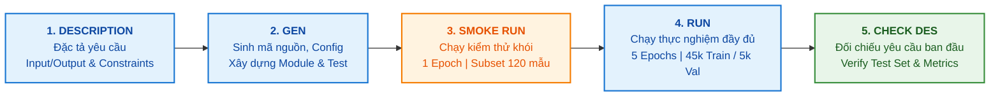

# AUDIT LOG: PHÁT TRIỂN & THỰC NGHIỆM LAB 2

**Dự án:** Pretrained Models, Transfer Learning & Fine-Tuning trên CIFAR-10 với ResNet-18 và DenseNet-121  
**Quy trình chuẩn hóa:** `Description -> Gen -> Smoke Run -> Run -> Check Description`  
**Tiêu chuẩn chất lượng:** Source-First, Design-First, Test-Driven, Reproducible, Definition of Done (DoD)

---

## 1. QUY TRÌNH VÒNG ĐỜI KỸ THUẬT (DEVELOPMENT LIFECYCLE)

---

## 2. CHI TIẾT NHẬT KÝ KIỂM TOÁN 5 GIAI ĐOẠN

### GIAI ĐOẠN 1: DESCRIPTION (ĐẶC TẢ YÊU CẦU & THIẾT KẾ RÀNG BUỘC)
- **Mục tiêu:** Xác định đầy đủ phạm vi bài toán Practice 2:
  - Khảo sát 2 họ kiến trúc Pretrained: **ResNet-18** và **DenseNet-121** (trọng số ImageNet-1K V1).
  - So sánh đối chứng hai chiến lược: **Transfer Learning** (Feature Extraction) vs. **Fine-Tuning**.
  - Khảo sát độ nhạy siêu tham số: Learning Rate ($10^{-3}$ vs. $10^{-4}$) và Batch Size ($16$ vs. $32$).
- **Đầu vào (Input):** 60.000 ảnh CIFAR-10 màu RGB $32 \times 32 \times 3$, 10 lớp cân bằng.
- **Đầu ra (Output):** Vector logits 10 chiều tương ứng 10 lớp phân loại.
- **Ràng buộc kỹ thuật (Constraints):**
  - Môi trường tính toán: CPU-First / CUDA-Ready (hỗ trợ cả CPU cá nhân và tăng tốc GPU).
  - Tránh rò rỉ dữ liệu (Data Leakage): Tập Test 10.000 ảnh hoàn toàn cách ly, chỉ đánh giá một lần duy nhất ở cuối trên Best Checkpoint.
  - Phân chia tập dữ liệu: 45.000 train / 5.000 validation / 10.000 test bằng hạt giống cố định `seed = 42`.
  - Giữ an toàn dữ liệu: Lưu checkpoint nguyên tử (Atomic save) qua file tạm `.tmp` để chống hỏng file khi gặp sự cố.

---

### GIAI ĐOẠN 2: GEN (SINH MÃ NGUỒN, MODULE & BỘ KIỂM THỬ)
- **Cấu hình trung tâm:** Tạo [`configs/config.yaml`](file:///d:/Hoc_Sau/Lab 2/configs/config.yaml) quản lý 6 cấu hình thực nghiệm độc lập (`core` và `hparam`).
- **Module lõi (`src/lab2/`):**
  - [`data.py`](file:///d:/Hoc_Sau/Lab 2/src/lab2/data.py): Xử lý nạp dữ liệu, phân chia `random_split`, pipeline transforms (Resize 128x128, Normalize ImageNet, Augmentation trên train).
  - [`models.py`](file:///d:/Hoc_Sau/Lab 2/src/lab2/models.py): Nạp pretrained backbones, thay thế classifier head 10 lớp, thiết lập cơ chế đóng băng (`requires_grad = False`) và mở khóa tầng sâu.
  - [`train.py`](file:///d:/Hoc_Sau/Lab 2/src/lab2/train.py): Vòng lặp huấn luyện chuẩn 6 bước, quản lý Loss & Accuracy, tích hợp TensorBoard và kiểm tra NaN/Inf loss.
  - [`checkpoint.py`](file:///d:/Hoc_Sau/Lab 2/src/lab2/checkpoint.py): Hàm `atomic_save`, `verify_checkpoint_integrity`, phân tách checkpoint `latest`, `best` và metadata verification.
  - [`evaluate.py`](file:///d:/Hoc_Sau/Lab 2/src/lab2/evaluate.py): Đánh giá checkpoint độc lập, tính Loss, Accuracy, Confusion Matrix và Per-class accuracy.
  - [`tensorboard_logger.py`](file:///d:/Hoc_Sau/Lab 2/src/lab2/tensorboard_logger.py): Quản lý luồng Scalars, Histograms, Sample Images, và Computational Graph.
- **Bộ kiểm thử tự động (`tests/`):** Xây dựng bộ **53 unit & integration tests** bao phủ toàn bộ chức năng dữ liệu, mô hình, kiểm soát gradient, checkpoint và độ tương thích.

---

### GIAI ĐOẠN 3: SMOKE RUN (CHẠY THỬ NGHIỆM KHÓI KIỂM CHỨNG NHANH)
- **Mục đích:** Xác minh code chạy thông suốt, không gặp lỗi cú pháp, lệch chiều tensor (shape mismatch), tràn bộ nhớ hay lỗi I/O trước khi tốn tài nguyên chạy full.
- **Cấu hình Smoke Run:**
  - Lệnh thực thi: `python scripts/run_experiments.py --smoke-test`
  - Số epoch: **1 epoch**
  - Quy mô dữ liệu: Subset **120 mẫu** train, **30 mẫu** val, **30 mẫu** test.
  - Batch size: 16
- **Kết quả xác minh:**
  - Forward pass và backward pass thành công 100% trên cả ResNet-18 và DenseNet-121.
  - Tensor shapes: Đầu vào `[16, 3, 128, 128]`, đầu ra `[16, 10]`, loss vô hướng `torch.Tensor([])`.
  - Tách namespace độc lập để không ghi đè dữ liệu lịch sử của lượt chạy chính thức.

---

### GIAI ĐOẠN 4: RUN (CHẠY THỰC NGHIỆM ĐẦY ĐỦ 6 CẤU HÌNH)
- **Thiết lập:** Huấn luyện đủ 5 epochs trên tập dữ liệu hoàn chỉnh (45.000 train / 5.000 val), đo thời gian và ghi nhận log TensorBoard chi tiết.
- **Kết quả 6 thí nghiệm thực tế (Trích xuất từ `outputs/metrics/summary.csv`):**

| Thí nghiệm ID | Epochs | Batch | LR (Head / Backbone) | Trainable Params | Train Loss / Acc (ep 5) | Best Val Acc (epoch) | Test Loss | **Test Acc** | Tổng thời gian |
|:---|:---:|:---:|:---:|:---:|:---:|:---:|:---:|:---:|:---:|
| `resnet18_transfer` | 5 | 16 | 1e-3 / — | 5.130 (0,05%) | 0.7718 / 73.85% | 77.94% (ep 2) | 0.6644 | **77.98%** | 05m 35s |
| `resnet18_finetune` | 5 | 16 | 1e-3 / 1e-4 | 8.398.858 (75,11%) | 0.2488 / 91.48% | 91.68% (ep 4) | 0.2989 | **90.24%** | 07m 15s |
| `densenet121_transfer` | 5 | 16 | 1e-3 / — | 10.250 (0,15%) | 0.6860 / 76.89% | 81.84% (ep 5) | 0.5560 | **81.34%** | 09m 03s |
| `densenet121_finetune` | 5 | 16 | 1e-3 / 1e-4 | 2.170.378 (31,17%) | 0.2912 / 89.94% | 90.78% (ep 5) | 0.2982 | **90.65%** | 10m 42s |
| `resnet18_transfer_lr1e4` | 5 | 16 | 1e-4 / — | 5.130 (0,05%) | 0.7605 / 73.96% | 77.56% (ep 5) | 0.6643 | **78.32%** | 06m 03s |
| `resnet18_transfer_bs32` | 5 | 32 | 1e-3 / — | 5.130 (0,05%) | 0.7029 / 76.12% | 78.92% (ep 4) | 0.6276 | **79.04%** | 05m 21s |

---

### GIAI ĐOẠN 5: CHECK DESCRIPTION (KIỂM TRA ĐỐI CHIẾU VỚI MÔ TẢ BAN ĐẦU)
- **Đối chiếu Rubric & DoD:**
  1. *Đúng bài toán phân loại 10 lớp CIFAR-10:* Đạt (tất cả các head kết thúc tại `Linear(..., 10)`).
  2. *Đánh giá độc lập trên tập Test:* Đạt (10.000 ảnh kiểm thử chỉ được nạp sau khi hoàn tất training, dùng best checkpoint).
  3. *So sánh đối chứng:*
     - Fine-Tuning vượt trội Transfer Learning (+12,26% trên ResNet, +9,31% trên DenseNet).
     - DenseNet tiết kiệm tham số hơn (2,17M trainable params vs. 8,40M của ResNet-18) nhưng chi phí tính toán cao hơn (10m42s vs 7m15s).
  4. *Khảo sát siêu tham số:*
     - Giảm LR xuống 1e-4 giúp hội tụ ổn định hơn (Test Acc tăng nhẹ lên 78,32%).
     - Tăng Batch Size lên 32 rút ngắn thời gian chạy xuống 5m21s và cải thiện độ chính xác lên 79,04%.
  5. *Đính chính tính nhất quán số liệu:* Khắc phục lỗi sao chép nhãn ban đầu (xác nhận lại `resnet18_transfer` là 77,98%, không bị trùng với 78,32% của `lr1e4`).
  6. *Kiểm tra hồi quy kiểm thử:* Toàn bộ 53/53 tests passed sau khi kết thúc toàn bộ chu trình.
