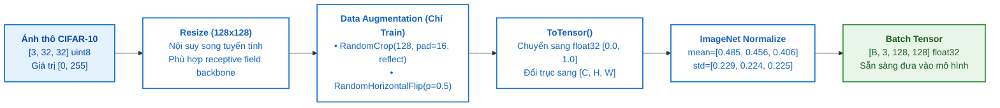

# TÀI LIỆU DỮ LIỆU: CIFAR-10, TIỀN XỬ LÝ & TRỰC QUAN HÓA (DATA.MD)

**Tập dữ liệu:** CIFAR-10 (Canadian Institute For Advanced Research)  
**Quy mô:** 60.000 ảnh màu RGB 3 kênh, 10 lớp cân bằng  
**Module triển khai:** [`src/lab2/data.py`](file:///d:/Hoc_Sau/Lab 2/src/lab2/data.py)  
**Tệp trực quan hóa:** [`docs/figures/cifar10_raw_samples_grid.png`](file:///d:/Hoc_Sau/Lab 2/docs/figures/cifar10_raw_samples_grid.png), [`docs/figures/cifar10_raw_distribution.png`](file:///d:/Hoc_Sau/Lab 2/docs/figures/cifar10_raw_distribution.png), [`docs/figures/cifar10_raw_pca.png`](file:///d:/Hoc_Sau/Lab 2/docs/figures/cifar10_raw_pca.png)

---

## 1. ĐẶC TÍNH KỸ THUẬT CỦA DỮ LIỆU THÔ

| Đặc tính | Giá trị kỹ thuật trong Lab 2 | Ý nghĩa thực tế |
|:---|:---|:---|
| **Tổng số lượng ảnh** | **60.000 ảnh** | 50.000 ảnh tập train gốc + 10.000 ảnh tập test gốc |
| **Kích thước ảnh thô** | **$32 \times 32$ pixels** | Độ phân giải thấp, đối tượng ít chi tiết cục bộ |
| **Số kênh màu** | **3 kênh (R, G, B)** | Tensor thô: $[32, 32, 3]$ hoặc $[3, 32, 32]$ |
| **Kiểu dữ liệu gốc** | `uint8` $[0, 255]$ | Dung lượng uncompressed 1 ảnh: $3.072\text{ bytes} \approx 3\text{ KB}$ |
| **Số lớp đối tượng** | **10 lớp cân bằng** | Đúng $6.000$ ảnh mỗi lớp (chiếm chính xác $10,0\%$ mỗi lớp) |
| **Danh mục 10 lớp** | `airplane`, `automobile`, `bird`, `cat`, `deer`, `dog`, `frog`, `horse`, `ship`, `truck` | 6 lớp sinh vật + 4 lớp phương tiện |
| **Phân chia trong Lab 2** | **45.000 Train / 5.000 Val / 10.000 Test** | Chia bằng `random_split(seed=42)` (75% / 8.33% / 16.67%) |

---

## 2. PHÂN CHIA TẬP DỮ LIỆU & BẢO VỆ TÍNH KHÁCH QUAN

- **Tập Huấn luyện (Train set):** 45.000 ảnh dùng để tối ưu hóa trọng số mô hình qua gradient descent.
- **Tập Kiểm chuẩn (Validation set):** 5.000 ảnh dùng để đánh giá mô hình sau mỗi epoch, phát hiện sớm overfitting và lựa chọn **Best Checkpoint** (`val_acc` cao nhất).
- **Tập Kiểm thử (Test set):** 10.000 ảnh hoàn toàn độc lập, **chưa từng được mô hình nhìn thấy trong suốt quá trình huấn luyện**, chỉ nạp vào đúng một lần duy nhất ở cuối cùng để đánh giá khách quan Best Checkpoint.
- **Tính tái lập (Reproducibility):** Cố định hạt giống ngẫu nhiên `seed = 42` trên toàn bộ hệ thống (`random.seed(42)`, `np.random.seed(42)`, `torch.manual_seed(42)`).

---

## 3. PIPELINE TIỀN XỬ LÝ & DATA AUGMENTATION

### 3.1. Phân biệt Transform giữa Train và Val/Test
Trích từ [`src/lab2/data.py`](file:///d:/Hoc_Sau/Lab 2/src/lab2/data.py#L31-L54):
- **Tập Train (Bao gồm Data Augmentation):**
  - `transforms.Resize((128, 128))`
  - `transforms.RandomCrop(128, padding=16, padding_mode="reflect")`: Tạo ra sự xê dịch vị trí vật thể, tăng tính bền vững không gian.
  - `transforms.RandomHorizontalFlip(p=0.5)`: Lật ảnh ngẫu nhiên theo trục ngang.
  - `transforms.ToTensor()`
  - `transforms.Normalize(mean=[0.485, 0.456, 0.406], std=[0.229, 0.224, 0.225])`
- **Tập Validation & Test (Deterministic - Không biến đổi ngẫu nhiên):**
  - `transforms.Resize((128, 128))`
  - `transforms.ToTensor()`
  - `transforms.Normalize(mean=[0.485, 0.456, 0.406], std=[0.229, 0.224, 0.225])`

### 3.2. Tại sao phải Resize lên 128x128?
ResNet-18 và DenseNet-121 có kiến trúc gồm 5 tầng giảm mẫu liên tiếp qua convolution stride=2 và max-pooling ($2^5 = 32$). Nếu đưa ảnh gốc $32 \times 32$ vào, kích thước không gian ở cuối backbone sẽ bị co về $1 \times 1$ ngay từ các khối giữa, khiến các bộ lọc sâu không còn thông tin không gian để học. Việc phóng to lên $128 \times 128$ đảm bảo đầu ra trước Global Average Pooling giữ được kích thước $4 \times 4$, cho phép trích xuất đặc trưng đầy đủ.

---

## 4. TRỰC QUAN HÓA DỮ LIỆU THÔ

### 4.1. Lưới ảnh mẫu đại diện 10 lớp đối tượng
Tệp hình ảnh: [`docs/figures/cifar10_raw_samples_grid.png`](file:///d:/Hoc_Sau/Lab 2/docs/figures/cifar10_raw_samples_grid.png)  
Hiển thị trực quan $60$ ảnh mẫu ($10$ lớp $\times 6$ mẫu/lớp) ở độ phân giải gốc $32 \times 32$, minh họa sự đa dạng về góc nhìn, màu lông động vật, phương tiện giao thông và nền ảnh.

### 4.2. Thống kê phân bố lớp và cường độ điểm ảnh 3 kênh RGB
Tệp hình ảnh: [`docs/figures/cifar10_raw_distribution.png`](file:///d:/Hoc_Sau/Lab 2/docs/figures/cifar10_raw_distribution.png)
- Cả 10 lớp đều có chính xác $6.000$ ảnh, loại bỏ hoàn toàn nguy cơ thiên vị lớp do mất cân bằng dữ liệu.
- Phân phối cường độ điểm ảnh của CIFAR-10 thô:
  - Kênh Đỏ (R): $\mu = 0,491, \quad \sigma = 0,247$
  - Kênh Lục (G): $\mu = 0,482, \quad \sigma = 0,243$
  - Kênh Lam (B): $\mu = 0,447, \quad \sigma = 0,262$

---

## 5. PHÂN TÍCH THÀNH PHẦN CHÍNH (PCA) TRÊN PIXEL THÔ

Tệp hình ảnh: [`docs/figures/cifar10_raw_pca.png`](file:///d:/Hoc_Sau/Lab 2/docs/figures/cifar10_raw_pca.png)  
Script thực thi: [`scripts/visualize_raw_pca.py`](file:///d:/Hoc_Sau/Lab 2/scripts/visualize_raw_pca.py)

### 5.1. Kết quả giảm chiều từ 3.072D về 2D (PC1 vs. PC2)
- Khi chiếu toàn bộ $3.072$ chiều thô ($32 \times 32 \times 3$) xuống 2 thành phần chính (PC1 và PC2):
  - **PC1 giải thích 28,7% phương sai.**
  - **PC2 giải thích 11,2% phương sai.**
  - Tổng phương sai giải thích bởi 2 thành phần chỉ đạt **$39,9\%$**. Cần đến $12$ thành phần để đạt $50\%$ và gần $60$ thành phần mới đạt $80\%$.
- **Hiện tượng chồng lấn dữ dội (Manifold Entanglement):** Điểm của 10 lớp nằm đan xen dày đặc ở vùng trung tâm. Các điểm trọng tâm (Centroids) của các lớp động vật (`cat`, `dog`, `deer`, `bird`, `frog`, `horse`) nằm co cụm tại $x \in [-4, 0], y \in [0.5, 2.0]$. Không có bất kỳ siêu phẳng tuyến tính nào có thể phân tách các lớp trong không gian pixel thô.

### 5.2. Bản chất các "Eigen-CIFAR"
Khi chiếu ngược 4 eigenvector đầu tiên về dạng ảnh $32 \times 32 \times 3$:
- **PC1:** Phản ánh độ sáng tổng thể của khung cảnh (đối tượng sáng trên nền tối hoặc ngược lại).
- **PC2:** Phản ánh dải màu phân cách theo chiều dọc (bầu trời xanh phía trên, mặt đất/cỏ xanh phía dưới).
- PCA tuyến tính hoàn toàn không bắt được các đặc trưng cấu trúc cục bộ như tai mèo, mắt, bánh xe hay cánh máy bay.

$\Rightarrow$ **Kết luận:** *Đây là bằng chứng toán học chứng minh bộ phân loại tuyến tính đơn giản không thể hoạt động hiệu quả trên pixel thô, và bắt buộc phải sử dụng các tầng tích chập sâu phi tuyến tính từ Pretrained CNN Backbones để ánh xạ dữ liệu sang không gian đặc trưng phân tách tuyến tính.*
