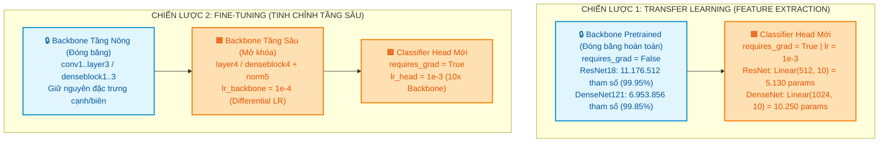

# BÁO CÁO TỔNG QUAN: LAB 2 — PRETRAINED MODELS, TRANSFER LEARNING & FINE-TUNING

**Học phần:** Deep Learning & Computer Vision  
**Chủ đề:** Thích nghi mô hình học sâu tiền huấn luyện (ImageNet-1K) sang phân loại ảnh CIFAR-10 với ResNet-18 và DenseNet-121  
**Môi trường thực thi:** PyTorch 2.x, Torchvision, TensorBoard, Python 3.10+  
**Tiêu chuẩn chất lượng:** Source-First, Design-First, Test-Driven, Reproducible (Seed 42)

---

## 1. TỔNG QUAN BÀI TOÁN & BỐI CẢNH THỰC HIỆN

### 1.1. Thách thức khi huấn luyện CNN từ đầu (From Scratch)
Trong thị giác máy tính, việc huấn luyện một mạng nơ-ron tích chập sâu (Deep CNN) hoàn toàn từ đầu trên các tập dữ liệu có quy mô vừa và nhỏ (như CIFAR-10) thường gặp hai trở ngại nghiêm trọng:
1. **Hiện tượng quá khớp (Overfitting):** Số lượng mẫu huấn luyện có hạn không đủ để tối ưu hóa hàng triệu trọng số tự do, khiến mô hình chỉ ghi nhớ nhiễu của tập huấn luyện mà không học được các đặc trưng khái quát.
2. **Chi phí tính toán và thời gian hội tụ:** Việc tối ưu từ khởi tạo ngẫu nhiên đòi hỏi hàng trăm epoch với chi phí năng lượng và thời gian tính toán rất lớn.

### 1.2. Giải pháp: Chuyển giao tri thức (Transfer Learning) từ ImageNet
**Tập dữ liệu nguồn (ImageNet-1K):** Chứa hơn 1,28 triệu ảnh tự nhiên thuộc 1.000 lớp danh mục phong phú. Mô hình được huấn luyện trên ImageNet đã tích lũy được bộ trích xuất đặc trưng không gian phân cấp (Hierarchical Feature Representation) mạnh mẽ:
- Các tầng tích chập nông học các bộ lọc phát hiện cạnh, góc, viền và kết cấu màu sắc mang tính phổ quát.
- Các tầng tích chập sâu kết hợp các biểu diễn này thành các bộ phận và đối tượng ngữ nghĩa đặc trưng cao cấp.

**Tác vụ đích (CIFAR-10):** Bộ dữ liệu gồm 60.000 ảnh màu $32 \times 32$ pixels thuộc 10 lớp (`airplane`, `automobile`, `bird`, `cat`, `deer`, `dog`, `frog`, `horse`, `ship`, `truck`). Mục tiêu là chuyển giao tri thức từ ImageNet sang bài toán phân loại CIFAR-10 hiệu quả nhất.

---

## 2. HAI CHIẾN LƯỢC THÍCH NGHI MÔ HÌNH CHỦ ĐẠO

### 2.1. Transfer Learning (Feature Extraction)
- **Cơ chế:** Toàn bộ xương sống trích xuất đặc trưng (backbone) được giữ nguyên và đóng băng trọng số (`param.requires_grad = False`). Tầng phân loại 1.000 lớp của ImageNet bị gỡ bỏ, thay thế bằng một tầng tuyến tính mới (`Linear(D, 10)`) được khởi tạo ngẫu nhiên và chỉ huấn luyện tầng này.
- **Ưu điểm:** Huấn luyện cực nhanh, số tham số cần cập nhật cực nhỏ (chỉ 0,05% ở ResNet-18 và 0,15% ở DenseNet-121), không có nguy cơ làm hỏng tri thức gốc của ImageNet.

### 2.2. Fine-Tuning (Tinh chỉnh với Differential Learning Rate)
- **Cơ chế:** Mở khóa các khối tích chập sâu nhất của backbone (khối `layer4` ở ResNet-18 hoặc `denseblock4` + `norm5` ở DenseNet-121) để cùng học với tầng phân loại mới.
- **Nguyên lý Tốc độ học vi phân (Differential Learning Rate):**
  $$\eta_{backbone} = 10^{-4}, \quad \eta_{head} = 10^{-3}$$
  Tốc độ học của backbone nhỏ hơn 10 lần so với head nhằm ngăn chặn **Hiện tượng quên thảm họa (Catastrophic Forgetting)** — việc các gradient lớn sinh ra từ đầu phân loại ngẫu nhiên phá hủy các bộ lọc đặc trưng đã học tối ưu trên ImageNet.

---

## 3. KIẾN TRÚC MÔ HÌNH KHẢO SÁT

| Mô hình | Họ kiến trúc | Cơ chế cốt lõi | Tổng tham số | Tham số Head mới | Kích thước Feature Vector |
|:---|:---|:---|:---:|:---:|:---:|
| **ResNet-18** | Residual Network | Kết nối tắt cộng dư: $\mathbf{y} = \mathcal{F}(\mathbf{x}) + \mathbf{x}$ | 11.181.642 | 5.130 (`Linear(512, 10)`) | 512 chiều |
| **DenseNet-121** | Densely Connected | Ghép nối đặc trưng: $\mathbf{x}_\ell = H_\ell([\mathbf{x}_0, \dots, \mathbf{x}_{\ell-1}])$ | 6.964.106 | 10.250 (`Linear(1024, 10)`) | 1.024 chiều |

---

## 4. MA TRẬN 6 THÍ NGHIỆM THỰC NGHIỆM

Dự án thiết kế ma trận 6 thí nghiệm chặt chẽ kiểm tra 3 khía cạnh khoa học:
1. **Khảo sát phương pháp thích nghi (Core):** `resnet18_transfer` vs. `resnet18_finetune`.
2. **Khảo sát họ kiến trúc (Core):** `densenet121_transfer` vs. `densenet121_finetune`.
3. **Khảo sát độ nhạy siêu tham số (Hparam):**
   - Tốc độ học: `resnet18_transfer_lr1e4` (LR $10^{-4}$ vs. $10^{-3}$).
   - Kích thước Batch: `resnet18_transfer_bs32` (Batch size $32$ vs. $16$).

---

## 5. ĐỐI CHIẾU TIÊU CHUẨN ĐÁNH GIÁ (RUBRIC COMPLIANCE)

| Yêu cầu Practice 2 | Trạng thái triển khai trong mã nguồn | File kiểm chứng |
|:---|:---:|:---|
| **Thử nghiệm nhiều pretrained models** | Đã triển khai hoàn chỉnh **ResNet-18** và **DenseNet-121** | [`src/lab2/models.py`](file:///d:/Hoc_Sau/Lab 2/src/lab2/models.py) |
| **Transfer Learning và Fine-Tuning** | Đầy đủ 2 phương pháp với cơ chế đóng băng và Differential LR | [`src/lab2/models.py`](file:///d:/Hoc_Sau/Lab 2/src/lab2/models.py), [`src/lab2/train.py`](file:///d:/Hoc_Sau/Lab 2/src/lab2/train.py) |
| **Thay Classifier theo 10 lớp CIFAR-10** | Thay thế `model.fc` (ResNet) và `model.classifier` (DenseNet) | [`src/lab2/models.py`](file:///d:/Hoc_Sau/Lab 2/src/lab2/models.py#L45-L75) |
| **Khảo sát Learning Rate** | Thử nghiệm $10^{-3}$ vs $10^{-4}$ có kiểm soát biến | [`configs/config.yaml`](file:///d:/Hoc_Sau/Lab 2/configs/config.yaml) |
| **Khảo sát Batch Size** | Thử nghiệm $16$ vs $32$ có kiểm soát biến | [`configs/config.yaml`](file:///d:/Hoc_Sau/Lab 2/configs/config.yaml) |
| **Đếm tham số mô hình** | Hàm `count_parameters()` đếm chính xác Trainable / Frozen | [`scripts/inspect_models.py`](file:///d:/Hoc_Sau/Lab 2/scripts/inspect_models.py) |
| **Tiền xử lý dữ liệu** | Resize $128 \times 128$, chuẩn hóa ImageNet, Data Augmentation | [`src/lab2/data.py`](file:///d:/Hoc_Sau/Lab 2/src/lab2/data.py) |
| **DataLoader & Train/Val/Test split** | 45.000 Train, 5.000 Val, 10.000 Test (seed 42) | [`src/lab2/data.py`](file:///d:/Hoc_Sau/Lab 2/src/lab2/data.py#L90-L130) |
| **Training & Validation loop** | Đầy đủ vòng lặp 6 bước, theo dõi Loss và Accuracy | [`src/lab2/train.py`](file:///d:/Hoc_Sau/Lab 2/src/lab2/train.py) |
| **Giám sát thời gian thực** | TensorBoard Scalars, Histograms, Image Samples, Graphs | [`src/lab2/tensorboard_logger.py`](file:///d:/Hoc_Sau/Lab 2/src/lab2/tensorboard_logger.py) |
| **Đánh giá trên tập Test độc lập** | Chỉ đánh giá checkpoint tốt nhất một lần ở cuối | [`src/lab2/evaluate.py`](file:///d:/Hoc_Sau/Lab 2/src/lab2/evaluate.py) |
