# TÀI LIỆU KIẾN TRÚC MÔ HÌNH: RESNET-18 & DENSENET-121 (MODEL.MD)

**Chủ đề:** Khảo sát kiến trúc mạng dư học sâu (ResNet-18) và mạng kết nối dày đặc (DenseNet-121) tiền huấn luyện trên ImageNet  
**Module triển khai:** [`src/lab2/models.py`](file:///d:/Hoc_Sau/Lab 2/src/lab2/models.py)  
**Tệp biểu đồ:** [`docs/figures/model_parameters_comparison.png`](file:///d:/Hoc_Sau/Lab 2/docs/figures/model_parameters_comparison.png), [`docs/figures/transfer_vs_finetune.png`](file:///d:/Hoc_Sau/Lab 2/docs/figures/transfer_vs_finetune.png)

---

## 1. SO SÁNH NGUYÊN LÝ KIẾN TRÚC CỐT LÕI

```mermaid
flowchart TD
    classDef resnetBox fill:#e3f2fd,stroke:#1976d2,stroke-width:2px,color:#0d47a1;
    classDef denseBox fill:#ede7f6,stroke:#512da8,stroke-width:2px,color:#311b92;
    classDef mathBox fill:#ffffff,stroke:#37474f,stroke-width:1.5px,color:#263238;

    subgraph R ["KIẾN TRÚC RESNET-18 (RESIDUAL ADDITION)"]
        R_IN["Đầu vào x"]:::resnetBox --> R_CONV["Khối tích chập F(x)<br/>2 tầng Conv 3x3 + BN + ReLU"]:::resnetBox
        R_IN -->|Skip Connection| R_ADD["Cộng phần dư (Addition):<br/>y = F(x) + x"]:::mathBox
        R_CONV --> R_ADD
        R_ADD --> R_OUT["Kích hoạt ReLU(y)"]:::resnetBox
    end

    subgraph D ["KIẾN TRÚC DENSENET-121 (DENSE CONCATENATION)"]
        D_IN["Đầu vào x_0"]:::denseBox --> D_L1["Tầng 1: H_1(x_0)"]:::denseBox
        D_IN --> D_CAT1["Ghép kênh: [x_0, x_1]"]:::mathBox
        D_L1 --> D_CAT1
        D_CAT1 --> D_L2["Tầng 2: H_2([x_0, x_1])"]:::denseBox
        D_CAT1 --> D_CAT2["Ghép kênh: [x_0, x_1, x_2]"]:::mathBox
        D_L2 --> D_CAT2
    end
```



### 1.1. ResNet-18 (Residual Networks - He et al., CVPR 2016)
- **Vấn đề giải quyết:** Hiện tượng suy biến gradient (vanishing gradient) khi mạng tích chập phát triển quá sâu.
- **Cơ chế kết nối tắt phần dư (Residual Skip Connection):**
  $$\mathbf{y} = \mathcal{F}(\mathbf{x}, \{W_i\}) + \mathbf{x}$$
  Thay vì bắt các tầng nơ-ron học ánh xạ gốc $\mathcal{H}(\mathbf{x})$, mạng học phần dư $\mathcal{F}(\mathbf{x}) = \mathcal{H}(\mathbf{x}) - \mathbf{x}$. Nhờ phép cộng trực tiếp $\mathbf{x}$, gradient trong quá trình lan truyền ngược có thể truyền thẳng qua nhánh tắt về các tầng nông mà không bị suy giảm theo cấp số nhân:
  $$\frac{\partial \mathcal{E}}{\partial \mathbf{x}} = \frac{\partial \mathcal{E}}{\partial \mathbf{y}} \left( \frac{\partial \mathcal{F}}{\partial \mathbf{x}} + \mathbf{I} \right)$$
- **Cấu trúc ResNet-18:**
  - `conv1` ($7 \times 7$, stride 2, 64 channels) + `bn1` + `maxpool` ($3 \times 3$, stride 2)
  - `layer1`: 2 BasicBlocks (64 channels)
  - `layer2`: 2 BasicBlocks (128 channels)
  - `layer3`: 2 BasicBlocks (256 channels)
  - `layer4`: 2 BasicBlocks (512 channels)
  - `avgpool`: AdaptiveAvgPool2d((1, 1)) $\to$ Feature vector 512 chiều.

### 1.2. DenseNet-121 (Densely Connected Networks - Huang et al., CVPR 2017)
- **Vấn đề giải quyết:** Tái sử dụng đặc trưng tối đa và giảm thiểu số lượng tham số dư thừa.
- **Cơ chế kết nối dày đặc (Dense Connectivity):** Mỗi tầng nhận toàn bộ bản đồ đặc trưng từ tất cả các tầng đi trước làm đầu vào thông qua phép ghép nối kênh (Channel Concatenation):
  $$\mathbf{x}_\ell = H_\ell([\mathbf{x}_0, \mathbf{x}_1, \dots, \mathbf{x}_{\ell-1}])$$
- **Tốc độ tăng trưởng kênh (Growth Rate $k=32$):** Mỗi dense layer chỉ sinh thêm đúng $k=32$ channels mới, giữ mô hình rất mỏng và tiết kiệm tham số.
- **Cấu trúc DenseNet-121:**
  - `denseblock1`: 6 dense layers
  - `transition1`: Conv $1 \times 1$ + AvgPool $2 \times 2$ (giảm số kênh và kích thước không gian)
  - `denseblock2`: 12 dense layers
  - `transition2`
  - `denseblock3`: 24 dense layers
  - `transition3`
  - `denseblock4`: 16 dense layers
  - `norm5`: BatchNorm2d(1024) + ReLU + AdaptiveAvgPool2d((1, 1)) $\to$ Feature vector 1.024 chiều.

---

## 2. TÙY BIẾN ĐẦU PHÂN LOẠI CHO CIFAR-10 (HEAD ADAPTATION)

Cả hai mô hình gốc từ ImageNet-1K đều có đầu phân loại 1.000 lớp. Trong Lab 2, đầu phân loại cũ bị loại bỏ và thay thế bằng tầng phân loại tuyến tính mới kết thúc tại 10 lớp đích:

```python
# ResNet-18 Head:
model.fc = nn.Linear(in_features=512, out_features=10)
# Số tham số: 512 * 10 (weights) + 10 (bias) = 5.130 tham số

# DenseNet-121 Head:
model.classifier = nn.Linear(in_features=1024, out_features=10)
# Số tham số: 1024 * 10 (weights) + 10 (bias) = 10.250 tham số
```

---

## 3. BẢNG PHÂN RÃ THAM SỐ CHI TIẾT (PARAMETER BREAKDOWN)

Số liệu trích xuất chính xác 100% qua hàm `count_parameters()` trong [`src/lab2/models.py`](file:///d:/Hoc_Sau/Lab 2/src/lab2/models.py#L110-L135):

| Thí nghiệm ID | Mô hình | Phương pháp | Tầng đóng băng (requires_grad=False) | Tầng huấn luyện (requires_grad=True) | Tổng tham số | Tham số Trainable | Tham số Frozen | Tỷ lệ Trainable |
|:---|:---:|:---:|:---|:---|:---:|:---:|:---:|:---:|
| `resnet18_transfer` | ResNet-18 | Transfer | `conv1`, `bn1`, `layer1`..`layer4` | `fc` (`Linear(512, 10)`) | 11.181.642 | **5.130** | 11.176.512 | **0,05%** |
| `resnet18_finetune` | ResNet-18 | Fine-Tuning | `conv1`, `bn1`, `layer1`..`layer3` | `layer4` + `fc` | 11.181.642 | **8.398.858** | 2.782.784 | **75,11%** |
| `densenet121_transfer` | DenseNet-121 | Transfer | Toàn bộ `features` | `classifier` (`Linear(1024, 10)`) | 6.964.106 | **10.250** | 6.953.856 | **0,15%** |
| `densenet121_finetune` | DenseNet-121 | Fine-Tuning | `features` đến `transition3` | `denseblock4` + `norm5` + `classifier` | 6.964.106 | **2.170.378** | 4.793.728 | **31,17%** |
| `resnet18_transfer_lr1e4` | ResNet-18 | Transfer | Toàn bộ backbone | `fc` | 11.181.642 | **5.130** | 11.176.512 | **0,05%** |
| `resnet18_transfer_bs32` | ResNet-18 | Transfer | Toàn bộ backbone | `fc` | 11.181.642 | **5.130** | 11.176.512 | **0,05%** |

---

## 4. PHÁT HIỆN KỸ THUẬT QUAN TRỌNG: HÀNH VI BATCHNORM BUFFER

Trong quá trình thực nghiệm Transfer Learning, nhóm phát hiện sự khác biệt bản chất giữa **Tham số (Parameters)** và **Bộ đệm thống kê (Buffers)** của các tầng Batch Normalization:

```python
# Đóng băng tham số học được:
for param in model.parameters():
    param.requires_grad = False
```

- **Vấn đề:** Lệnh `requires_grad = False` chỉ vô hiệu hóa gradient đối với trọng số tự do `weight` ($\gamma$) và độ lệch `bias` ($\beta$). Lệnh này **không hề đóng băng các buffer thống kê** (`running_mean`, `running_var`, `num_batches_tracked`).
- **Thực nghiệm kiểm chứng ([`scripts/check_frozen_bn.py`](file:///d:/Hoc_Sau/Lab 2/scripts/check_frozen_bn.py)):**
  - Khi gọi `model.train()`: Các tầng BatchNorm trong backbone dù đã set `requires_grad = False` vẫn tự động cập nhật running mean và running variance theo batch dữ liệu CIFAR-10 hiện tại:
    - ResNet-18: **60/60 buffers** thay đổi giá trị.
    - DenseNet-121: **363/363 buffers** thay đổi giá trị.
  - Khi gọi `model.eval()`: Các buffer hoàn toàn đóng băng (**0 buffer thay đổi**).
- **Ý nghĩa:** Điều này lý giải tại sao mô hình Transfer Learning có thể thích nghi nhẹ phân phối đặc trưng sang CIFAR-10 ngay cả khi toàn bộ trọng số backbone đã bị khóa.

