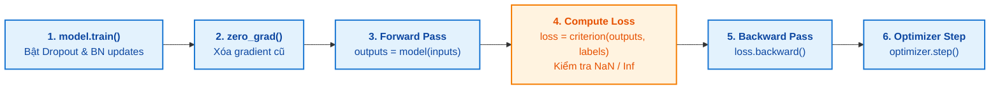

# TÀI LIỆU QUY TRÌNH HUẤN LUYỆN: THIẾT KẾ, OPTIMIZER & CHECKPOINT (TRAINING.MD)

**Chủ đề:** Thiết kế vòng lặp huấn luyện, tối ưu hóa tốc độ học vi phân (Differential LR), kiểm soát an toàn nguyên tử (Atomic Checkpoint) và hệ thống giám sát TensorBoard  
**Module triển khai:** [`src/lab2/train.py`](file:///d:/Hoc_Sau/Lab 2/src/lab2/train.py), [`src/lab2/checkpoint.py`](file:///d:/Hoc_Sau/Lab 2/src/lab2/checkpoint.py), [`src/lab2/tensorboard_logger.py`](file:///d:/Hoc_Sau/Lab 2/src/lab2/tensorboard_logger.py)  
**Tệp sơ đồ:** [`outputs/figures/monitoring_architecture.png`](file:///d:/Hoc_Sau/Lab 2/outputs/figures/monitoring_architecture.png), [`outputs/figures/slide_08_train_validation_checkpoint.png`](file:///d:/Hoc_Sau/Lab 2/outputs/figures/slides/slide_08_train_validation_checkpoint.png)

---

## 1. THIẾT LẬP SIÊU THAM SỐ TOÀN CỤC (GLOBAL HYPERPARAMETERS)

| Siêu tham số | Giá trị thiết lập | Lý do kỹ thuật |
|:---|:---|:---|
| **Thuật toán tối ưu (Optimizer)** | **Adam** | Thích ứng mô-men quán tính, hội tụ nhanh trên các bài toán thích nghi |
| **Hàm mất mát (Loss)** | **CrossEntropyLoss** | Phân loại đa lớp xác suất với Softmax tích hợp |
| **Hệ số Weight Decay (L2)** | **$10^{-4}$ (0.0001)** | Tránh bùng nổ trọng số tự do ở classifier head |
| **Kích thước Batch (Batch size)** | **16** (và **32** ở thí nghiệm mở rộng) | Tối ưu hóa bộ nhớ CPU/GPU cá nhân và độ ổn định gradient |
| **Số lượng Epochs** | **5 epochs** | Đủ để tầng phân loại hội tụ mà không gây quá khớp (overfitting) |
| **Tốc độ học (Learning Rate)** | **$10^{-3}$ (Head) / $10^{-4}$ (Backbone)** | Chiến lược tốc độ học vi phân bảo vệ trọng số ImageNet |
| **Hạt giống ngẫu nhiên (Seed)** | **42** | Đảm bảo 100% khả năng tái lập trên mọi môi trường máy tính |

---

## 2. CHIẾN LƯỢC TỐC ĐỘ HỌC VI PHÂN (DIFFERENTIAL LEARNING RATE)

Khi thực hiện Fine-Tuning, nếu áp dụng cùng một tốc độ học lớn $\eta = 10^{-3}$ cho cả mô hình, các gradient lớn sinh ra từ đầu phân loại ngẫu nhiên sẽ phá vỡ toàn bộ cấu trúc trọng số đã tối ưu của ImageNet ở các tầng tích chập sâu.

Hệ thống triển khai 2 nhóm tham số độc lập trong Adam:
```python
def create_optimizer(model: nn.Module, cfg: ExperimentConfig) -> optim.Optimizer:
    if cfg.method == "finetune" and cfg.backbone_lr is not None:
        # Nhóm 1: Backbone sâu (lr = 1e-4)
        # Nhóm 2: Head mới (lr = 1e-3)
        backbone_params = [p for n, p in model.named_parameters() if "fc" not in n and "classifier" not in n and p.requires_grad]
        head_params = [p for n, p in model.named_parameters() if ("fc" in n or "classifier" in n) and p.requires_grad]
        param_groups = [
            {"params": backbone_params, "lr": cfg.backbone_lr},
            {"params": head_params, "lr": cfg.learning_rate}
        ]
        return optim.Adam(param_groups, weight_decay=cfg.weight_decay)
    else:
        # Transfer Learning: chỉ tối ưu các tham số requires_grad=True (Head)
        trainable_params = [p for p in model.parameters() if p.requires_grad]
        return optim.Adam(trainable_params, lr=cfg.learning_rate, weight_decay=cfg.weight_decay)
```

$$\eta_{backbone} = 10^{-4} = \frac{1}{10} \eta_{head}$$

---

## 3. CHU TRÌNH HUẤN LUYỆN 6 BƯỚC MỖI EPOCH

Mỗi epoch huấn luyện trải qua 6 bước toán học nghiêm ngặt trong hàm `train_one_epoch()`:



### 3.1. Vòng lặp Validation và Kiểm soát Lỗi Tính toán
- Sau mỗi epoch, mô hình lập tức chuyển sang chế độ đánh giá: `model.eval()`.
- Toàn bộ tính toán được bọc trong `with torch.no_grad():` để triệt tiêu việc cấp phát đồ thị tính toán (Computational Graph), tiết kiệm bộ nhớ và đẩy nhanh tốc độ thực thi.
- **Bảo vệ chống phân kỳ (NaN/Inf Guard):** Nếu gặp giá trị `loss` bất thường (NaN hoặc $\pm\infty$), hệ thống ghi log lỗi nghiêm trọng và ném ngoại lệ `FloatingPointError` thay vì tiếp tục làm hỏng trọng số.

---

## 4. QUẢN LÝ CHECKPOINT AN TOÀN NGUYÊN TỬ VỚI LOSS VÀ ACCURACY

Hệ thống phân tách rõ ràng trách nhiệm giữa các loại file checkpoint tại thư mục `checkpoints/`:

```
checkpoints/
├── <exp>_latest.pth       # Luôn lưu trạng thái của epoch gần nhất (dùng resume)
├── <exp>_best.pth         # Snapshot hoàn chỉnh của epoch có val_acc cao nhất
├── <exp>_weights.pth      # Chỉ chứa model_state_dict (nhẹ, phục vụ inference)
└── <exp>_best_meta.json   # Metadata xác thực: seed, val_split, best_val_acc
```

### 4.1. Cơ chế ghi nguyên tử (Atomic Save)
Để ngăn ngừa tình trạng file checkpoint bị lỗi hoặc hỏng hoàn toàn khi xảy ra sự cố ngắt nguồn hoặc dừng đột ngột, hàm `atomic_save()` trong [`src/lab2/checkpoint.py`](file:///d:/Hoc_Sau/Lab 2/src/lab2/checkpoint.py#L17-L44) thực hiện:
1. Ghi toàn bộ dữ liệu ra một file tạm thời tiền tố `tmp_*.tmp` cùng thư mục.
2. Gọi hàm hệ thống `os.replace(tmp_path, target_path)` để hoán đổi file tức thời.

### 4.2. Logic cập nhật Best Checkpoint theo Metric
```python
is_best = False
if cfg.checkpoint_metric == "val_acc":
    if val_acc > best_metric:
        best_metric = val_acc
        best_epoch = epoch
        is_best = True
else:
    if val_loss < best_metric:
        best_metric = val_loss
        best_epoch = epoch
        is_best = True

if is_best:
    save_checkpoint(state=checkpoint_state, filepath=latest_ckpt_path, is_best=True, best_filepath=best_ckpt_path)
```

---

## 5. HỆ THỐNG GIÁM SÁT THỜI GIAN THỰC (TENSORBOARD MONITORING)

Tệp sơ đồ kiến trúc: [`outputs/figures/monitoring_architecture.png`](file:///d:/Hoc_Sau/Lab 2/outputs/figures/monitoring_architecture.png)

Hệ thống tích hợp module [`TensorBoardLogger`](file:///d:/Hoc_Sau/Lab 2/src/lab2/tensorboard_logger.py) truyền phát 4 luồng dữ liệu song song:
1. **Scalars Monitor:** Theo dõi đường cong `Loss/train`, `Loss/val`, `Accuracy/train`, `Accuracy/val` và thời gian thực thi từng epoch, cho phép phát hiện sớm hiện tượng quá khớp.
2. **Histograms Monitor:** Theo dõi sự tiến hóa của phân phối trọng số và gradient ở từng tầng (`conv1`, `layer1-4`, `fc`, `features`, `classifier`), kiểm chứng các tầng bị khóa không có gradient.
3. **Image Batch Monitor:** Hiển thị ảnh sau khi qua pipeline tiền xử lý và augmentation (Resize 128x128), đảm bảo hình ảnh đầu vào không bị méo lệch phân phối.
4. **Computational Graph Monitor:** Đồ thị tính toán PyTorch JIT (`torch.jit.trace`) xác thực luồng tensor và kích thước đầu ra 10 lớp.

